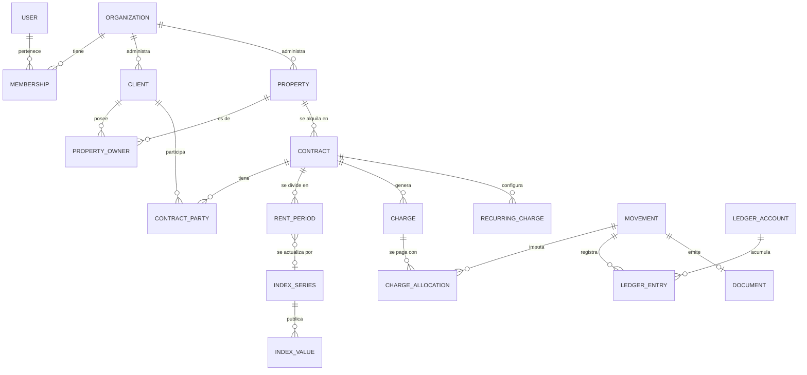

# 04 — Modelo de datos

Postgres (Supabase). Nombres de tablas y columnas en inglés, `snake_case`. Este documento define entidades y relaciones; el esquema exacto vive en las migraciones de Drizzle.

## Convenciones

- **Clave primaria:** `id uuid` (`gen_random_uuid()`; pasar a UUID v7 cuando Supabase use Postgres 18).
- **Multi-tenant:** toda tabla de negocio tiene `organization_id uuid not null`, con índice y **Row Level Security** que solo permite filas de organizaciones donde el usuario es miembro (ver [05-arquitectura](05-arquitectura.md)).
- **Número visible:** las entidades que el usuario ve numeradas (`contracts`, `clients`, `properties`, `movements`, `documents`, `incidents`) tienen `number int` correlativo **por organización** (`unique(organization_id, number)`), asignado por un trigger de Postgres (`private.assign_number`) con la tabla `org_counters`; el número no cambia nunca.
- **Direcciones:** columnas embebidas en cada tabla (`street, street_number, unit, city, region, postal_code, address_country`), no una tabla aparte. `region` es un código del `CountryPack` (provincia, estado, región). Lo mismo aplica donde abajo dice `address_id`.
- **Hijos de otra tabla** (contactos, cuentas, titulares) repiten `organization_id`; las políticas RLS verifican que coincida con el del padre.
- **Auditoría:** `created_at`, `updated_at`, `created_by`. Borrado lógico con `deleted_at` donde aplica (contratos, clientes, propiedades). Los asientos contables nunca se borran.
- **Dinero:** `numeric(14,2)` + columna `currency char(3)`.
- **Enums:** como tipos de Postgres o tablas de referencia si dependen del país.

## Diagrama general

## Organización, usuarios y planes

**organizations**
`id, name, legal_name, tax_id, tax_condition, country_code (AR, MX, CL...), default_currency, timezone, locale, logo_path, signature_path, address_id, email, phone, settings jsonb, plan_id, subscription_status, trial_ends_at, onboarding_completed_at`

`settings` agrupa preferencias que no se consultan por SQL: defaults de punitorios, honorarios, método de cobro, modo IPC (provisorio/real), opciones de impresión, avisos automáticos activos, plantillas de mensajes.

**users** — gestionada por Supabase Auth (`auth.users`) + `profiles(id, first_name, last_name, phone, avatar_path)`.

**memberships**
`id, organization_id, user_id, role (admin | operator | custom), permissions jsonb, invited_by, created_at`

**invitations**
`id, organization_id, email, role, token_hash, expires_at, accepted_at`

**plans** — `id, code, name, max_active_contracts, price, currency, country_code, features jsonb`
**subscriptions** — `id, organization_id, plan_id, provider (mercadopago), provider_subscription_id, status, current_period_end`
**subscription_payments** — `id, subscription_id, amount, currency, status, paid_at, provider_payment_id`

**audit_log** — `id, organization_id, actor_id, entity_type, entity_id, action, changes jsonb, created_at`

## Clientes y propiedades

**clients**
`id, organization_id, number, kind (person | company), first_name, last_name, company_name, doc_type, doc_number, tax_id, tax_condition, nationality, birth_date, <dirección>, notes, deleted_at` (implementado)

**client_contacts** — `id, organization_id, client_id, type (email | phone), value, label, is_primary` (implementado; WhatsApp usa el teléfono)
**bank_accounts** — `id, organization_id, owner_type (client | organization), client_id, bank_name, holder_name, account_number, cbu_cvu, alias, tax_id, currency`

**buildings** (F2) — `id, organization_id, name, address_id`

**properties**
`id, organization_id, number, building_id (F2), <dirección>, type (apartment | house | commercial | office | parking | land | other), status (available | rented | unavailable), cadastral_id, notes, deleted_at` (implementado)

**property_owners** — `property_id, client_id, ownership_pct numeric(5,2)` (suma 100 por propiedad)

## Contratos y períodos

**contracts**
`id, organization_id, number, property_id, status (draft | active | finished | terminated | renewed), start_date, end_date, original_end_date, currency, initial_amount, first_billed_month, index_series_id (null = sin actualización), index_mode (index | fixed_pct | none), fixed_pct, update_frequency_months, fee_type (pct | fixed), fee_value, fees_on_late_interest bool, late_interest_daily_pct, due_day, late_interest_from (day_1 | after_due), collection_method, default_cash_account_id, default_owner_bank_account_id, renewed_to_contract_id, finished_at, creation_source (web | csv | ai), deleted_at`

**contract_parties** — `contract_id, client_id, role (owner | tenant | guarantor), share_pct`
(los propietarios del contrato se copian de la propiedad al crearlo y pueden ajustarse)

**contract_events** — `id, contract_id, type (created | extended | early_termination | renewed | finished | reopened), payload jsonb, reason, created_by, created_at`

**rent_periods**
`id, contract_id, period_number, start_month, end_month, status (initial | pending_index | calculated | provisional | manually_adjusted), previous_amount, amount, index_series_id, index_start_date, index_start_value, index_end_date, index_end_value, variation_pct, calculated_at, notes`

## Índices

**index_series** — `id, country_code, code (AR_IPC, AR_ICL, AR_CASA_PROPIA, CL_UF, CO_UVR, MX_INPC, UY_UI...), name, frequency (daily | monthly), source_url, publisher`

**index_values** — `series_id, date, value numeric(20,6), is_provisional, published_at, fetched_at` (`unique(series_id, date)`)

Tablas globales (sin `organization_id`), de solo lectura para usuarios, escritas por el proceso de importación de índices.

## Deudas y gastos

**recurring_charges**
`id, organization_id, contract_id, title, currency, debtor (tenant | owner), creditor (owner | administration | third_party), applies_fee bool, start_month, end_month, frequency_months, timing (in_advance | in_arrears), last_amount, requires_confirmation bool, deleted_at`

**charges** (cada deuda concreta)
`id, organization_id, contract_id, type (rent | late_interest | recurring | one_off | fee | adjustment | bank_commission), period_month, installment_number, title, amount, currency, debtor, creditor, applies_fee, status (pending | partially_paid | paid | void), is_confirmed, due_date, recurring_charge_id, rent_period_id, calc_explanation text, created_at`

**charge_allocations** (qué parte de cada pago cubre cada deuda)
`id, movement_id, charge_id, amount`

## Movimientos, contabilidad y documentos

**movements** (cada operación de dinero que hace un usuario)
`id, organization_id, number, type (tenant_payment | owner_settlement | manual_income | manual_expense | transfer | reversal), date, client_id, method (cash | transfer_to_admin | transfer_to_owner | split_transfer | online), cash_account_id, total_amount, currency, notes, reversed_by_id, created_by`

**movement_contracts** — `movement_id, contract_id` (una liquidación puede abarcar varios contratos)

**cash_accounts** (cajas y cuentas de la administración) — `id, organization_id, type (cash | bank), name, bank_account_id, currency, is_default`

**ledger_accounts** — `id, organization_id, type (cash | tenant | owner | fees | admin_charges | third_party | other_income | expenses), ref_id, currency` (`ref_id`: la caja, o el contrato para inquilino, propietarios y terceros)

**ledger_entries**
`id, organization_id, posting_id, movement_id, charge_id, account_id, direction (debit | credit), amount, currency, date, concept, reversal_of_id, created_at`
Restricción: por cada `posting_id` (un registro o una reversa), débitos = créditos; se valida al confirmar la transacción.

**documents**
`id, organization_id, type (receipt | settlement), number (correlativo por tipo), movement_id (único), data jsonb (foto de lo que imprime), status (issued | void), issued_at, voided_at, created_by` — el PDF se genera a pedido desde `data`; `debt_notice` e `invoice` se suman en F2/F3

**document_links** — `id, organization_id, document_id, token_hash, expires_at, created_by` (links públicos para compartir; se leen con `public.shared_document(hash)`)

## Comunicaciones

**message_templates** — `id, organization_id, type, channel (email | whatsapp), subject, body, updated_by` (solo las versiones propias de cada inmobiliaria; las de fábrica están en `packages/emails`)
**communications**
`id, organization_id, contract_id, client_id, movement_id, type (receipt | settlement | payment_reminder | late_notice | amount_update | contract_expiry), channel (email | whatsapp_link), sender (manual | automatic), to_address, subject, body, status (queued | sent | delivered | bounced | failed), provider_message_id, error, attempts, dedupe_key (única por organización; obligatoria en los automáticos), sent_at, created_by` — después de creada solo cambian los datos de entrega; `whatsapp_api` y `owner_payment_notice` llegan en F2

## Facturación electrónica (F3)

**fiscal_points_of_sale** — `id, organization_id, provider (arca | sat | sii | dian), number, tax_id, legal_name, tax_condition, gross_income_condition, activity_start_date, address_id, credentials_ref (referencia al secreto, nunca el secreto), status`
**invoices** — `id, organization_id, point_of_sale_id, movement_id, client_id, type (A | B | C | ...), number, issue_date, service_from, service_to, net_amount, tax_amount, total_amount, currency, authorization_code (CAE), authorization_expires, provider_payload jsonb`
**invoice_lines** — `invoice_id, description, quantity, unit_price, tax_rate, subtotal`

## Otros

**incidents** — `id, organization_id, number, property_id, contract_id, title, description, priority, status, assignee_id, created_by`
**notes** — `id, organization_id, entity_type, entity_id, content, highlight_scope (none | tenant | owner | general), created_by`
**files** — `id, organization_id, entity_type (contract | movement | client | property), entity_id, storage_path, filename, mime_type, size_bytes, created_by` (el contrato firmado es un archivo más del contrato)

## Portales (F3)

**portal_users** — `id, email, name` (separados de los usuarios internos)
**portal_access** — `portal_user_id, organization_id, client_id, role (tenant | owner)`

## Pendientes de decidir

- ¿`charges` de punitorios se crean al pagar (como Krenta) o se proyectan diariamente para los reportes de mora? Propuesta: se crean al pagar y en los reportes se calculan al vuelo.
- Particionado de `ledger_entries` si alguna organización supera millones de filas (no antes de F4).
